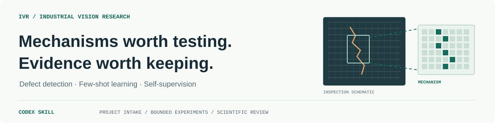

<p align="center">
  
</p>

<h1 align="center">AI Research Workflow</h1>

<p align="center">
  <strong>从真实研究问题，到有证据支持、可复现的实验贡献。</strong><br>
  面向 Codex、倾向计算机视觉与视觉模型研究的科研实验 skill，涵盖检测、分割、异常检测及相关小样本、自监督研究。工业视觉是应用场景之一。
</p>

<p align="center">
  <a href="https://github.com/boji1334/ai-research-workflow/actions/workflows/validate.yml"></a>
  <a href="https://github.com/boji1334/ai-research-workflow/releases/tag/v0.2.0"></a>
  <a href="skills/ai-research-workflow/scripts/research_guard.py"></a>
  <a href="LICENSE"></a>
</p>

<p align="center">
  <a href="README.md">English</a> ·
  <a href="#快速开始">快速开始</a> ·
  <a href="#研究流程">研究流程</a> ·
  <a href="docs/DESIGN.md">设计说明</a> ·
  <a href="docs/VALIDATION.zh-CN.md">验证记录</a> ·
  <a href="#引用">引用</a>
</p>

本技能为 Codex 提供一套可执行的研究规程：先了解已有项目和论文要求，再定位前沿研究机会、查新、设计机制、实现模块、做有限实验并审查证据。工作流止于实验交付，包含代码、结果、消融、审查记录和复现材料。

**当前状态：v0.2.0，实验性预览版。** 软件检查和隔离上下文的合成场景检查已记录在[验证记录](docs/VALIDATION.zh-CN.md)中。真实视觉研究项目的端到端有效性仍待验收；新颖性、效果与论文目标达成情况需要实际项目证据。

## 核心能力

| 能力 | 实际研究行为 |
| --- | --- |
| **先了解项目** | 先读材料、补齐项目事实，再确认目标期刊或级别、OA 偏好和可接受周期。 |
| **定位研究机会** | 从最近邻实际解决的范围和项目限制中选择具体问题，记录机制差异、区分实验、预算与决策节点。 |
| **查到机制层面** | 对比最近邻原文、公式、监督与实现路径，区分新机制、换名和已知增强。 |
| **分阶段科学审查** | 小试准入、扩大实验和贡献验收分别判断；问题绑定实际阻断阶段，正式报告独立定稿后再核验和汇总。 |
| **有限候选搜索** | 首次小试无提升后，最多追加两轮有依据的小规模修复；关闭失败候选后，在剩余预算内寻找不同机制。 |
| **实验围绕贡献** | 按实际主张和论文目标安排强基线、公平对比、消融、稳定性、泛化与成本证据。 |
| **有记录地接续** | 保留协议、候选族、运行标识、原始产物、失败、审查和下一步，支持跨会话继续。 |

## 快速开始

[技能本体](skills/ai-research-workflow)包含规程、参考文件、模板及可选 Python 工具。训练使用项目约定的执行环境；安装技能无需安装 Docker、AI Scientist v3 或上游科研套件。

### 1. 安装技能

若当前 Codex 会话中有官方 `skill-installer`，输入：

```text
$skill-installer Install the skill from https://github.com/boji1334/ai-research-workflow/tree/main/skills/ai-research-workflow
```

也可从 [Releases](https://github.com/boji1334/ai-research-workflow/releases) 下载独立技能 ZIP 和 `SHA256SUMS`，将解压后的 `ai-research-workflow` 文件夹放入研究项目的 `.agents/skills/`，最终目录为：

```text
你的研究项目/.agents/skills/ai-research-workflow/SKILL.md
```

更新同名技能前先比较版本和本地修改，安装后启动新的 Codex 会话。发现方式与作用范围见 [OpenAI 官方技能文档](https://developers.openai.com/codex/skills/)。

### 2. 接手项目

```text
$ai-research-workflow 接手当前视觉模型研究项目。
先读已有材料并问清项目事实，再确认我的论文目标和周期，之后再提实验方案。
```

提供已有代码、数据说明与划分、基线结果、历史尝试和执行资源，或它们可访问的位置。缺失事实在访谈中补齐。调用技能先进入项目沟通；训练以约定好的研究协议为依据。

### 3. 继续或审查

```text
$ai-research-workflow 继续当前研究。
先核对最新协议、实际活动进程、候选历史和审查证据，再推进下一步。
```

```text
$ai-research-workflow 审查这个模块与最近邻工作的差异，
以及已有实验是否支持机制解释。这次只审查。
```

联网查新需要当前可用的检索和浏览能力；实际训练需要项目本地或远端环境、数据权限、算力与存储预算。有可用 Codex 子代理时，可用隔离上下文复核，审查记录注明实际方式。

## 研究流程

<p align="center">
  
</p>

*图 1：先从项目证据与前沿工作定位研究机会，再选择机制；内层验证有限修复假设。研究范围与剩余预算跨候选保留。*

1. **明确项目并定位机会。** 补齐事实和固定需求，确认目标与资源，再对照前沿范围和项目限制确定具体问题及决策节点。
2. **选择并审查机制。** 核对假设、最近邻差异和实现路径；小试前写清最小区分实验及不同结果的解释。
3. **做小规模验证。** 先检查实现与评价链路，再做小试；对负结果或不明确结果提出具体修复假设。
4. **补齐实验。** 具备新颖性依据，且初步收益经结果复核后，完成协议要求的公平比较与贡献所需证据。
5. **复核并交付。** 根据原始产物复算结论，报告目标是否达成、部分达成或仍缺依据。

详细状态、产物、审查标准与终止逻辑见[设计说明](docs/DESIGN.md)。

### 什么时候继续，什么时候结束？

| 情况 | 后续动作 |
| --- | --- |
| 有提升，但新颖性不足 | 保留为已知增强，继续寻找有依据的新机制。 |
| 有新颖性依据，但没有提升 | 复核实现、公平性和机制假设；首次小试后最多再做两轮有依据的小规模修复。 |
| 修复用尽或机制被否定 | 关闭该候选；在原研究范围和剩余资源内提出不同机制。 |
| 创新性依据、效果、必要实验和结果审查均达标 | 完成实验阶段交付。 |
| 周期或资源到限，用户未同意延长 | 交真实阶段成果和未达项。 |

SCI 顶刊目标需转化为项目级证据要求，覆盖强基线、稳定收益、机制、泛化和成本；没有适用于所有任务的统一涨点承诺。预计超期时提前说明差距，未经调整就遵守原周期。

## 实验交付内容

- 代码版本、配置、命令、环境、数据角色和评价协议。
- 基线与候选结果、预先计划的有效重复、原始产物及权重位置。
- 与贡献对应的对比、消融、机制、泛化和计算成本实验。
- 模块审查、结果审查、负结果、局限和复现入口。

研究产物保存在项目约定的位置；公共仓库分发技能和合成验证夹具。

## 可选运行登记工具

[`research_guard.py`](skills/ai-research-workflow/scripts/research_guard.py) 使用 Python 3.10+ 标准库，可检查协议结构、冻结摘要、登记唯一运行指纹、限制修复槽并记录证据文件哈希。

```text
python SKILL_DIR/scripts/research_guard.py check-contract --contract research-contract.json
python SKILL_DIR/scripts/research_guard.py status --registry research-runs.json
```

将 `SKILL_DIR` 替换为已安装技能的实际目录。初始化、预留、完成与恢复操作见[命令说明](skills/ai-research-workflow/references/state-and-delivery.md)。

登记工具负责机械检查，训练由 Codex 和项目执行工具启动。科学判断、实际进程、GPU 小时和磁盘配额需要分别核实。当前审查放行由研究规程和执行者落实，CLI 尚未校验审查报告是否批准。

## 文档与验证

| 文档 | 内容 |
| --- | --- |
| [设计说明](docs/DESIGN.md) | 范围、流程、审查、有限迭代和科研技能整合。 |
| [v0.2.0 验证](docs/VALIDATION-0.2.0.md) | 研究定位、分阶段小试准入、预算接续及预设实验决策的合成检查。 |
| [中文验证记录](docs/VALIDATION.zh-CN.md) · [English](docs/VALIDATION.md) | 已完成的软件与内部行为检查，以及待做的真实研究验证。 |
| [技能入口](skills/ai-research-workflow/SKILL.md) | Codex 实际加载的规程。 |
| [设计来源](skills/ai-research-workflow/references/sources.md) | 固定到已查阅提交的上游来源与适配边界。 |
| [发布与迁移说明](docs/RELEASE-NOTES-0.2.0.md) | 版本、安装和发布信息。 |
| [变更记录](CHANGELOG.md) | 仓库改动。 |
| [测试前审查](docs/AUDIT-2026-10-26.zh-CN.md) · [项目试用清单](docs/PILOT-TEST.zh-CN.md) | 本轮发现、修订与真实试用的观察条件。 |

本地复核：

```text
python -m unittest discover -s tests -v
python tools/validate_repository.py
```

当前版本有 40 项软件测试，CI 覆盖 Windows/Linux × Python 3.10/3.12。合成检查覆盖研究定位与分阶段决策，实际结果见版本验证记录。阶段汇报分别列出模型新增、证据新增和工程恢复，继承成绩保留原版本归属；真实科研有效性仍需公平实验与完整证据。

## 整合的科研技能与方法

本技能综合以下科研技能与研究流程方法，面向视觉模型研究整合为统一工作流：

- [ARS-Codex · academic-research-suite](https://github.com/Imbad0202/academic-research-skills-codex)：研究问题澄清、分阶段推进与来源核验。
- [Orchestra Research · brainstorming-research-ideas](https://github.com/Orchestra-Research/AI-Research-SKILLs/tree/773a52944ba4747a18bd4ae9ade53fff041adcbc/21-research-ideation/brainstorming-research-ideas)：从真实瓶颈形成研究问题与机制假设。
- [Orchestra Research · autoresearch](https://github.com/Orchestra-Research/AI-Research-SKILLs/tree/773a52944ba4747a18bd4ae9ade53fff041adcbc/0-autoresearch-skill)：内外两层实验循环、协议预设与负结果记录。
- [K-Dense · scientific-critical-thinking](https://github.com/K-Dense-AI/scientific-agent-skills/tree/593377bb048752abb0152deab9fbb1083a6087df/skills/scientific-critical-thinking)：证据质量、混杂因素、机制解释与结果审查。
- [Nature Skills · nature-reviewer](https://github.com/Yuan1z0825/nature-skills/tree/07009f91f99c7108519e7657885f1a89d91099d5/skills/nature-reviewer)：隔离审查报告、定稿后数值与来源核验、可追踪的问题解决标准。
- [Nature Skills · nature-academic-search](https://github.com/Yuan1z0825/nature-skills/tree/07009f91f99c7108519e7657885f1a89d91099d5/skills/nature-academic-search)：多源查新、版本关联去重、引用核验与单源故障处理。
- [AI Scientist v3 · 研究流程方法](https://github.com/SakanaAI/AI-Scientist-v3)：研究阶段接续、运行标识与实验产物追踪。

正式模块和最终结果审查默认三份隔离内部报告；小试与局部复核可按风险和预算缩减并记录限制。发现问题不增加实验额度，两轮修复上限继续生效；评价目标仍以用户约定的期刊和任务为准。

具体整合范围与适配记录见[来源说明](skills/ai-research-workflow/references/sources.md)。

## 引用

引用本软件可使用 GitHub 的 **Cite this repository** 或 [`CITATION.cff`](CITATION.cff)：

```bibtex
@software{ai_research_workflow_2026,
  author  = {{boji1334}},
  title   = {AI Research Workflow},
  version = {0.2.0},
  year    = {2026},
  url     = {https://github.com/boji1334/ai-research-workflow}
}
```

[设计说明](docs/DESIGN.md)描述当前实现和局限。本版本尚无配套研究论文。

欢迎通过 Issues 提交带版本号和脱敏最小例子的问题或建议。私有数据、凭据、未发表研究细节与权重保留在约定的项目存储位置。

本仓库原创内容使用 [MIT License](LICENSE)。
