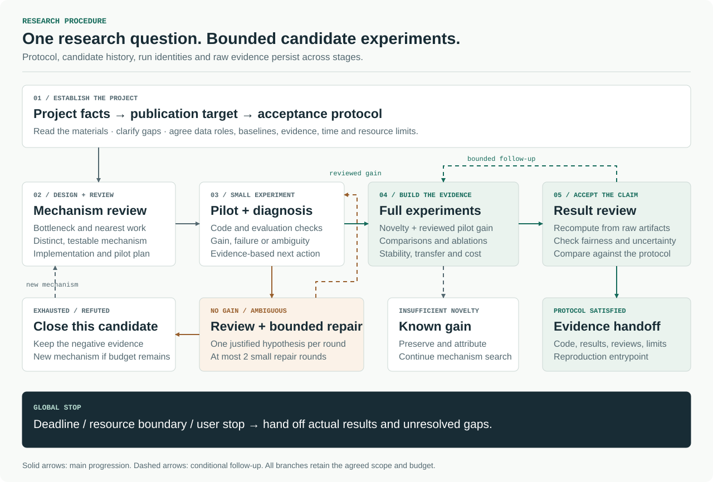

# AI Research Workflow: design note

**Implementation:** v0.3.0 experimental skill. **Document date:** October 30, 2026.

This note describes the procedure implemented by the [skill](../skills/ai-research-workflow/SKILL.md), its optional run registry, and its current validation limits. It is project documentation. Research effectiveness on a real vision research project is an open validation task.

## 1. Problem and scope

The skill addresses a specific research workflow: a researcher has a vision model research problem and needs to develop a defensible mechanism, determine whether it improves on fair baselines, and assemble sufficient experimental evidence for a stated publication goal.

The skill focuses on computer vision and vision model research, including detection, segmentation, anomaly detection, and related few-shot and self-supervised research. Industrial vision is one application. The rename preserves the established intake, experiment, review, and stopping rules; it does not introduce protocols for unrelated AI domains. It supports an existing project or a project whose facts are established through intake. Its terminal output is an experimental evidence package. Manuscript drafting and submission are separate follow-on requests.

The guiding principle is that a contribution must connect **a real bottleneck → a distinct mechanism → a testable prediction → observable evidence**. A renamed module, an isolated best seed, or a finished training command does not establish that chain.

## 2. Execution model

The implementation has three parts:

| Part | Actual responsibility |
| --- | --- |
| Skill instructions and references | Guide Codex's research decisions, intake, evidence collection, reviews, and handoff. |
| Codex and available project tools | Read sources, inspect and edit code, launch agreed experiments, inspect processes, and analyze actual artifacts. |
| Optional `research_guard.py` | Enforce structural contract and run-registration constraints using a local JSON registry. |

The skill package supplies no resident service, training engine, or scheduler. The research project supplies its actual environment, data, evaluation implementation, and job management. The registry's contents must be reconciled with real process state before resuming work.

The research lead, implementer, and reviewer are responsibilities, not a requirement for different model providers. Where supported, isolated Codex subagents can perform key reviews. Their output is identified as internal review with isolated context. Single-context self-review is recorded as such. Neither arrangement is described as external peer review.

## 3. Project intake and protocol

Intake first reads the existing project material, then asks only about unresolved requirements or facts. Project questions precede publication questions. The [intake reference](../skills/ai-research-workflow/references/intake.md) defines the relevant facts.

| Phase | Facts that must be established |
| --- | --- |
| Project | Task, current bottleneck, code and baseline, train/validation/test roles, prior attempts, fixed constraints, and allowed changes. |
| Resources | Execution target and owner, compute and storage budgets, active runs, and total run limit. |
| Publication | Target journal or level, access preference, applicable requirements, start date, deadline, and timezone. |
| Acceptance | Primary metric and direction, meaningful effect and rationale, planned repeats, fairness controls, and required evidence. |

The [contract template](../skills/ai-research-workflow/assets/research-contract.json) records these decisions. Structural completeness is checked by the helper; the facts and scientific adequacy require researcher and execution-context evidence.

### Publication target and acceptance

A top-tier SCI journal goal becomes a project-specific evidence contract informed by the target journal and relevant high-quality work:

- Compare the closest current mechanisms using their original papers and available implementations; state the search scope and unresolved neighbors.
- Use strong, relevant baselines with disclosed training, pretraining, external-data, evaluation, and tuning budgets.
- Judge the primary effect against observed variability and the task's practical value. Preserve all planned valid repeats and relevant class-level regressions.
- Use ablations and controls that distinguish the proposed mechanism from additional capacity, data, resolution, or optimization.
- Collect generalization and cost evidence where needed to support the actual claim.
- Confirm reproducibility and the limits of the conclusion from raw artifacts.

There is no fixed percentage-point threshold that implies top-tier readiness across tasks. A journal target does not establish global firstness or guarantee acceptance. The threshold, scope, and evidence are agreed for the project; approaching a deadline does not silently lower them.

## 4. Stages and artifacts

| Stage | Inputs | Required record | Decision |
| --- | --- | --- | --- |
| Intake | Existing project materials and user requirements | Resolved facts, remaining gaps, target, deadline | Clarify or establish protocol |
| Research positioning | Closest sources, project failures and fixed constraints | Solved scope, supported opportunity, uncertainty, cost and decision checkpoint | Select a candidate, run a bounded decision probe, or propose a scope adjustment |
| Mechanism design | Failure evidence and closest prior work | Candidate family, hypothesis, differences, implementation path, distinguishing test | Enter module review |
| Module review | Candidate, target references, dataset evidence, code plan and protocol | Evidence-linked target fit, data relevance, necessity and reliability assessment | Revise, known enhancement, close, or supported design followed by pilot admission |
| Pilot and bounded repair | Reviewed candidate and small-run budget | Code/config/data/seed identity, command, outputs, reviewed outcome | Expand evidence, justify repair, or close |
| Full experiments | Supported novelty and reviewed pilot gain | Fair baselines, comparisons, necessary ablations and claim-specific evidence | Enter final result review |
| Result review | Raw results, code, evaluator, protocol and claim | Recomputed metrics, confounds, stability, gaps, review verdict | Complete evidence or bounded follow-up |
| Handoff | Evidence and review records | Reproduction entrypoint, artifacts, supported claims, negative results, limits | Research success or partial delivery |

Projects can reuse their existing ledger and artifact layout. These are information requirements; they do not require a second competing directory structure. The [candidate](../skills/ai-research-workflow/assets/candidate.md) and [review](../skills/ai-research-workflow/assets/review.md) templates provide starting records.

### Research positioning and opportunity selection

The [positioning procedure](../skills/ai-research-workflow/references/positioning.md) distinguishes the research direction, concrete problem, candidate mechanism and supporting evidence. Prior work in a direction supplies a starting point. A missing experiment in one paper does not establish an unsolved problem; a known component does not establish equivalence of the complete mechanism. Equivalence and novelty claims require source and algorithm evidence.

Record which task/data/technical choices are fixed and which are preferences. Tie a candidate to a documented nearest-neighbor limit and a project observation or falsifiable hypothesis. Compare relevant effective methods as well as the original baseline. Choose a bounded next action for its ability to change the research decision and its real cost; do not invent novelty scores or predicted success probabilities. The [opportunity template](../skills/ai-research-workflow/assets/opportunity.md) is optional when the project already has equivalent records.

At a project-specific positioning checkpoint, produce a selected candidate, a finite probe that resolves a decision, or the actual gap and a concrete scope-adjustment proposal. Fixed task changes, including unseen-class protocols, require resolution of user requirements before implementation. Renaming a scenario or accepting lower absolute scores does not establish a contribution.

## 5. Two scientific reviews

### Module review

Review the existence of the bottleneck, coverage of nearest prior work, mathematical or algorithmic differences, assumptions, and permitted information flow. Check whether tensor interfaces, gradients, training and inference paths are coherent and whether an experiment can distinguish the proposed explanation from obvious confounds.

Within this same review, complete [target-led design admission](../skills/ai-research-workflow/references/admission.md): target fit, dataset relevance, mechanism necessity and design reliability each need traceable reasons. Compare the contribution against relevant target-level work, connect actual project facts to the hypothesis, assess simpler alternatives, and resolve known critical design defects. A different formula, a runnable implementation or an auxiliary-task phenomenon is not sufficient.

Record `design_supported`, `needs_design_revision`, `known_enhancement` or `close_candidate` in the [admission record](../skills/ai-research-workflow/assets/admission.md) or an equivalent project record. Bind it to the target, method/code and data-evidence version. `design_supported` enables assessment of `proceed_to_pilot`; pending dynamic engineering requirements can still require `revise_before_pilot`. It supports a reasoned investment under the user's goal, not a guaranteed journal level, gain or defect-free method.

Separate design admission, pilot execution, experimental expansion and final contribution acceptance. Missing measured gain, full ablations or cross-dataset results do not automatically block a design-supported pilot. Missing target fit, the dataset-to-mechanism rationale or design necessity does block candidate training. Demonstrated leakage, information loss contradicting the claim, logical/implementation errors and a non-discriminating design affect the corresponding action. A proven equivalent method may remain a properly attributed necessary baseline/control. Every finding identifies the affected claim/stage and the evidence needed there.

Before design admission, bounded literature/fact checks, synthetic counterexamples and read-only diagnostics with existing weights may resolve specific gaps. Candidate optimizer updates, short-effect trials and training smoke remain candidate experiments regardless of a diagnostic, probe or engineering label. After admission, real dynamic engineering checks and training stay within the original budget. Changes to a method require review of affected admission criteria; unchanged valid evidence and cumulative histories are reused.

### Result review

Result review applies to pilot evidence before expanding experiments and to the full evidence package before accepting a contribution.

Inspect original predictions or logs, evaluation code, configuration, and the frozen protocol. Recompute the quantities supported by those artifacts. Check baseline strength, excluded runs, repeats, uncertainty, test-set use, weak classes, ablations, external information, and computational cost.

Available decisions are `evidence_complete`, `needs_bounded_followup`, `gain_without_supported_novelty`, and `unsupported_or_negative`. `evidence_complete` reports novelty support, performance acceptance, and required experiment coverage separately.

Every material finding locates evidence and states its effect on the claim, severity, smallest justified correction, and verification method. Reviewers receive the research question and actual artifacts without an expected verdict. Conflicting judgments are resolved against sources, recomputation, or a discriminating small test. Agreement alone is not empirical evidence.

Formal module and final-result reviews default to three isolated internal reports over one frozen source packet, with emphases chosen in advance. Reports are frozen before a separate numerical/provenance audit and synthesis. Pilot and scoped reviews can reduce the count with recorded limits. No shared concern ledger or other report is supplied to a reviewer before freezing; review consensus and audit findings remain separate.

Material issues carry stable IDs, affected claims/stages, blocking status, resolution tests, and recheck evidence. Open blockers prevent the affected transition or acceptance. Review findings do not create extra repair rounds or extend the deadline. Search records separately track source failures, linked paper versions, citation identity, and support for a specific claim.

**Current enforcement boundary:** design admission is a mandatory procedural precondition for candidate training, implemented in the existing module review rather than an additional standing review panel. The optional registry does not read admission reports or judge publication quality. Successful registration does not grant scientific admission; the executor checks the actual record and blockers. This remains explicit in v0.3.0. See the [review procedure](../skills/ai-research-workflow/references/review.md).

## 6. Negative results and bounded search

Candidate-level stopping and project-level stopping are separate decisions.

Before a pilot, record the primary outcome and the meaning of positive, null, downstream-negative and engineering-failure results. Identify the closest effective method and the smallest necessary mechanism/capacity/budget control. A positive ablation result supports a bounded explanation, not unique causality or automatic research success. Initial baseline/control subruns can belong to a declared pilot batch; they do not bypass the registry's existing independent `control` admission rule.

| Observation | Interpretation and action |
| --- | --- |
| Gain, insufficient novelty | Keep the engineering improvement with its proper attribution. Preserve the original baseline and compare against both in later work. Continue the mechanism search if resources remain. |
| Novelty support, no gain | Inspect implementation, gradient behavior, information flow, fairness, and the falsifiable mechanism prediction. A repair requires a specific evidence-based hypothesis and a bounded test. |
| Neither novelty nor gain | Close or reject the candidate when the evidence already refutes its basis; additional trials are not an entitlement. |
| Novelty support and preliminary gain | Complete the agreed evidence package before claiming research success. |
| New reproducible phenomenon contradicts the original hypothesis | Form and check a new hypothesis; preserve the original negative result. |

An initial pilot may be followed by **at most two small repair rounds**. Each round freezes one repair hypothesis and its total training budget. Replicate seeds or support sets belong to the round's preplanned total budget. The allowance can end earlier when the mechanism is refuted or resources run out.

The same mechanism retains its candidate-family identity across renaming, small parameter changes, and configuration splits. A closed candidate can be followed by a genuinely different mechanism within the fixed research question and remaining global budget. A fresh name or registry file does not reset history.

Positioning, literature, review and engineering recovery have project-specific cumulative time/resource boundaries and concrete decision checkpoints. Report total remaining resources, active reservations and actually available resources separately. Reallocation preserves commitments, history and frozen-contract rules. A new directory or candidate does not reset those budgets.

The helper conservatively consumes a repair slot when it is reserved, including a later cancelled or invalid run. A project that needs a more detailed infrastructure-failure policy must specify and retain it in its protocol. See [experiment rules](../skills/ai-research-workflow/references/experiments.md).

## 7. Run tracking and reproducibility

Associate each run with the protocol, code revision, data version, configuration, seed or support-set sampling, command, device, budget, logs, outputs, and checkpoint location. An evidence file must support the stated outcome. Planned comparisons and ablations use a declared `control` record: their scores do not replace the latest full-method outcome, and all records count toward the global run budget. Preserve failures and cancelled work.

The optional registry offers `check-contract`, `init`, `reserve`, `finish`, and `status`. It freezes a contract digest, serializes updates using local file locking, rejects duplicate fingerprints, checks active candidate registrations and total run limits, and records evidence-file SHA-256 hashes. Initialization publishes a fully written registry without replacing an existing one on supported local filesystems.

The registry does not compute scientific metrics, inspect training processes, recognize equivalent mechanisms, meter GPU use, or validate a reviewer verdict. An evidence hash identifies bytes; it does not prove scientific correctness or provide tamper-proof auditing. Existing equivalent project tooling may be used instead. See [registry and recovery details](../skills/ai-research-workflow/references/state-and-delivery.md).

## 8. Completion and handoff

| State | Meaning |
| --- | --- |
| `candidate_closed` | A candidate has ended; the project may continue with a new mechanism. |
| `research_success` | Supported novelty, agreed gains, necessary evidence, and result review satisfy the project protocol. |
| `partial_delivery` | The deadline, resource boundary, or user-requested handoff arrives with unresolved research requirements. |

Estimate the remaining experimental and review work using observed run times. If the target appears out of reach, explain the gap early and ask whether the user wants to adjust the deadline or goal. Without an agreed change, deliver stage results at the original boundary. User instructions to stop or redirect also end the current plan.

Handoff includes source revision, reproducible configurations and commands, environment, raw result and checkpoint locations, comparisons and ablations, reviews, limitations, and negative results. Scientific success, software checks, and deadline compliance are reported separately.

Stage reports separately identify model changes and measured gains, added scientific evidence, and engineering recovery. Attribute inherited models and scores to their original versions. Choosing a research line, implementing a candidate, completing a pilot, freezing the final method and completing the evidence are distinct states; review reports and reproduction of an old score do not count as a new model improvement.

## 9. Research skills and methods

The skill synthesizes complementary research skills and workflow methods into a procedure focused on vision model research.

| Research skill or method | Contribution to the synthesis |
| --- | --- |
| ARS-Codex · `academic-research-suite` | Research-question clarification, staged progression, and source verification. |
| Orchestra Research · `brainstorming-research-ideas` | Research questions and mechanism hypotheses grounded in real bottlenecks. |
| Orchestra Research · `autoresearch` | Inner and outer experiment loops, predefined protocols, and negative-result records. |
| K-Dense · `scientific-critical-thinking` | Evidence quality, confounds, mechanism explanations, and result review. |
| Nature Skills · `nature-reviewer` | Frozen source packets, isolated reports, post-review numerical/provenance audits, and issue resolution tests. |
| Nature Skills · `nature-academic-search` | Multi-source discovery, version reconciliation, citation identity/support separation, and source-failure handling. |
| AI Scientist v3 · research workflow methods | Stage continuity, run identities, and experimental-artifact tracking. |

The [provenance record](../skills/ai-research-workflow/references/sources.md) links the inspected revisions and documents each source's adaptation to this skill.

## 10. Validation and open work

The [validation record](VALIDATION.md) distinguishes static checks, 40 software tests, packaging, synthetic isolated-context checks, and internal code review. The CI matrix covers Windows/Linux and Python 3.10/3.12. These results validate the tested software behavior and specific procedure examples.

The next research validation task is a real vision research pilot: complete intake, check the mechanism against original sources, run small implementation and training checks, verify recovery and resource control, and audit fair comparisons and ablations. Scientific effectiveness remains unmeasured until those artifacts exist.

Potential stronger enforcement of review approvals should be evaluated against observed use. It is not a claimed capability of the current helper.
